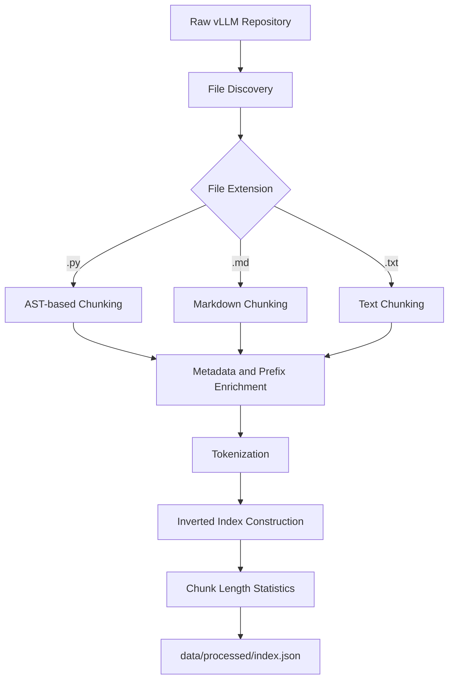
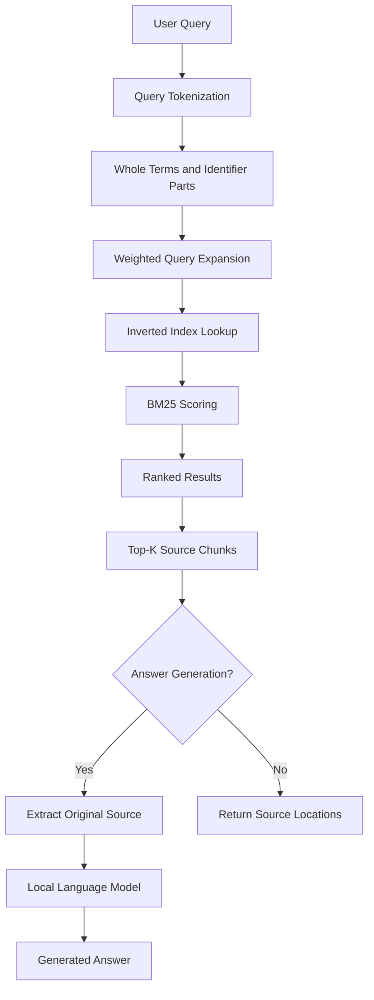

*This project is part of the 42 curriculum, created by etchipoq.*

# RAG Against the Machine 🤖
### Building a smarter retrieval system for the vLLM codebase

## Description

**RAG Against the Machine** is a Retrieval-Augmented Generation (RAG) project focused on retrieving relevant information from the [vLLM](https://github.com/vllm-project/vllm) codebase.

The objective is to build a system capable of understanding questions about both technical documentation and source code, locating the most relevant sections, and providing those sources as context for answer generation.

Rather than relying on a traditional keyword search, this implementation combines structured document chunking, custom tokenization, an inverted index, and the BM25 ranking algorithm.

The project is divided into two main responsibilities:

- **Retrieval:** Find the most relevant source-code or documentation chunks for a given question.
- **Generation:** Use the retrieved context to produce a concise answer with a locally configured language model.

The main focus of this implementation is retrieval quality, particularly the challenge of searching source code where identifiers, function names, class names, and file paths often contain important information.

## Instructions

### Requirements

- Python 3.12 or newer
- [uv](https://docs.astral.sh/uv/) for dependency management
- Access to the vLLM source repository under `data/raw/vllm-0.10.1/`
- A compatible local language model setup for answer generation

### Installation


Install the project dependencies:

```bash
uv sync
```

Make sure the vLLM source code is available under:

```text
data/
└── raw/
    └── vllm-0.10.1/
```

### Building the index

Before searching, the source files must be processed and indexed.

```bash
uv run python -m src index --max_chunk_size 2000
```

This command:

1. Reads supported `.py`, `.md`, and `.txt` files.
2. Splits their content into manageable chunks.
3. Extracts searchable terms and identifier components.
4. Builds an inverted index.
5. Saves the resulting index to `data/processed/index.json`.

The index only needs to be rebuilt when the source content or indexing configuration changes.

### Searching the codebase

Run a search directly from the terminal:

```bash
uv run python -m src search "How does ModelRunner execute a request?" --k 5
```

The system returns the most relevant source locations, including their file paths and character offsets.

The `--k` argument controls how many results are returned.

### Generating an answer

To generate an answer using the retrieved context:

```bash
uv run python -m src answer "How does ModelRunner execute a request?" --k 5
```

The system retrieves the top-ranked sources and passes their original content to the configured local language model.

### Searching an entire dataset

The project also supports batch retrieval.

For example, to search the public code questions:

```bash
uv run python -m src search_dataset \
    --dataset_path data/datasets_public/public/UnansweredQuestions/dataset_code_public.json \
    --k 10 \
    --save_directory data/output/public
```

For documentation questions:

```bash
uv run python -m src search_dataset \
    --dataset_path data/datasets_public/public/UnansweredQuestions/dataset_docs_public.json \
    --k 10 \
    --save_directory data/output/public
```

The retrieved sources are saved as JSON files in the specified output directory.

### Evaluating retrieval results

The project uses the Moulinette evaluation tool to compare retrieved sources against the ground-truth datasets.

Evaluate code retrieval:

```bash
./moulinette evaluate_student_search_results \
    data/output/public/dataset_code_public.json \
    data/datasets_public/public/AnsweredQuestions/dataset_code_public.json \
    --k 10 \
    --max_context_length 2000
```

Evaluate documentation retrieval:

```bash
./moulinette evaluate_student_search_results \
    data/output/public/dataset_docs_public.json \
    data/datasets_public/public/AnsweredQuestions/dataset_docs_public.json \
    --k 10 \
    --max_context_length 2000
```

The evaluation reports Recall@1, Recall@3, Recall@5, and Recall@10.

## Resources

| Resource | Description |
|---|---|
| [vLLM](https://github.com/vllm-project/vllm) | Source repository used as the retrieval corpus |
| [Python AST](https://docs.python.org/3/library/ast.html) | Python abstract syntax tree used for source-code parsing |
| [Python Regular Expressions](https://docs.python.org/3/library/re.html) | Pattern matching and text tokenization |
| [BM25](https://en.wikipedia.org/wiki/Okapi_BM25) | Information retrieval ranking algorithm |
| [uv](https://docs.astral.sh/uv/) | Python package and project management |
| [Pydantic](https://docs.pydantic.dev/) | Data validation and structured models |

---

## System Architecture

The system follows a two-stage architecture: indexing and retrieval, followed by optional answer generation.

### 1. Indexing pipeline

The indexing stage transforms the raw vLLM repository into a searchable representation.



The indexing process is implemented primarily in:

- `src/__main__.py`
- `src/chunker.py`
- `src/tokenizer.py`

The resulting index stores:

- Original chunk content.
- Source file paths and character offsets.
- Token-to-chunk mappings.
- Term frequencies.
- Individual chunk lengths.
- Average chunk length.

### 2. Retrieval and generation pipeline



Retrieval and answer generation are deliberately separated. This allows the search engine to be evaluated independently of the language model.

---

## Chunking Strategy

A good retrieval system depends heavily on how its source material is divided.

The implementation uses different chunking strategies depending on the file type.

### Python source files — AST-based chunking

Python files are parsed using the built-in `ast` module.

Instead of splitting code arbitrarily, the system identifies top-level:

- Functions (`FunctionDef`)
- Classes (`ClassDef`)
- Asynchronous functions (`AsyncFunctionDef`)

Each definition becomes a natural chunking boundary.

Code outside these definitions is also retained and divided when necessary.

This approach helps preserve logical code structures and makes it easier to retrieve complete functions or classes.

The implementation uses `ast.parse()` to build the syntax tree and character offsets to map AST line numbers back to the original file.

### Markdown files — heading-aware chunking

Markdown files are divided using heading boundaries.

The system recognizes headings from level 1 to level 6 and avoids treating headings inside fenced code blocks as actual document boundaries.

This helps maintain the organization of technical documentation, keeping related explanations within the same section.

### Text files — paragraph-based chunking

Plain-text files are split around paragraph boundaries, using blank lines as separators.

Fenced code blocks are tracked to avoid splitting their contents at internal blank lines.

### Chunk size and overlap

The default maximum chunk size is 2,000 characters.

To reduce information loss at chunk boundaries, the implementation introduces a 20% overlap.

For a 2,000-character chunk:

- Maximum chunk size: 2,000 characters
- Overlap: 400 characters
- Sliding step: 1,600 characters

This allows consecutive chunks to share context, increasing the likelihood that relevant information remains available even when an explanation or code structure crosses a chunk boundary.

### Metadata and prefix enrichment

Each chunk receives additional searchable context derived from its file path and, where available, its function or class name.

For example:

```text
File: vllm/worker/model_runner.py
Symbol: execute_model
```

This information is added to an `index_text` representation used during indexing.

The original source remains stored separately as `text`.

This distinction is important: metadata improves retrieval, while the original source is preserved for answer generation and source references.

---

## Retrieval Method

The retrieval engine uses a custom lexical search implementation based on an inverted index and BM25.

### 1. Custom tokenization

Tokenization is implemented in `src/tokenizer.py`.

The system uses Python's `re` library to extract alphanumeric sequences and identifiers.

It preserves complete identifiers while also extracting their individual components.

For example:

| Original identifier | Searchable components |
|---|---|
| `ModelRunner` | `modelrunner`, `model`, `runner` |
| `max_num_seqs` | `max_num_seqs`, `max`, `num`, `seqs` |
| `HTTPServer` | `httpserver`, `http`, `server` |
| `Qwen3Model` | `qwen3model`, `qwen`, `3`, `model` |

This is particularly useful in source-code retrieval because users often describe an identifier using separate words rather than its exact original spelling.

The implementation distinguishes between documentation and Python source:

- Documentation tokenization removes common grammatical stop words, with a fallback if every token is removed.
- Python tokenization retains programming keywords and identifiers because they can be important for code retrieval.

### 2. Identifier-aware query expansion

Queries undergo the same identifier-aware tokenization process.

For example:

```text
Find ModelRunner
```

Can produce:

```python
whole = ["find", "modelrunner"]
parts = ["model", "runner"]
```

Common stop words are removed, and duplicate components already represented by complete query terms are excluded.

This enables partial identifier matching without sacrificing exact identifier matching.

### 3. Inverted index

The index maps each token to the chunks in which it appears and its term frequency.

Conceptually:

```python
{
    "modelrunner": {
        12: 2,
        35: 1
    },
    "runner": {
        12: 1,
        18: 3
    }
}
```

This structure makes it possible to find candidate chunks without scanning the entire repository for every query.

---

## Algorithms and Ranking Mechanisms

### BM25 — Best Matching 25

BM25 is the ranking algorithm used to score candidate chunks according to their relevance to a query.

It considers:

- **Term Frequency (TF):** How frequently a query term appears in a chunk.
- **Inverse Document Frequency (IDF):** How informative or rare the term is across the indexed collection.
- **Document Length Normalization:** Adjusts for differences in chunk length.

The implementation uses the following parameters:

| Parameter | Value | Purpose |
|---|---:|---|
| `K1` | 1.5 | Controls term-frequency saturation |
| `B` | 0.75 | Controls document-length normalization |
| `PART_WEIGHT` | 0.5 | Reduces the influence of identifier components |

The IDF component is calculated as:

\[
IDF(t)=\ln\left(1+\frac{N-df(t)+0.5}{df(t)+0.5}\right)
\]

Where:

- \(N\) is the total number of indexed chunks.
- \(df(t)\) is the number of chunks containing term \(t\).

The BM25 contribution for a term is:

\[
BM25(t,d)=IDF(t)\cdot
\frac{TF(t,d)(K_1+1)}
{TF(t,d)+K_1(1-B+B\frac{|d|}{avgdl})}
\]

Where:

- \(TF(t,d)\) is the term frequency in chunk \(d\).
- \(|d|\) is the chunk length.
- \(avgdl\) is the average chunk length.

### Weighted identifier matching

A key retrieval improvement is the distinction between complete identifiers and their components.

The ranking system assigns:

- Weight of `1.0` to complete query terms.
- Weight of `0.5` to additional identifier components.

The final score is the sum of the weighted BM25 contributions:

\[
Score(d,q)=
\sum_{t\in q_{whole}} BM25(t,d)
+
0.5\sum_{p\in q_{parts}} BM25(p,d)
\]

This allows a query for `runner` to match a chunk containing `ModelRunner`, while preserving a stronger signal for an exact identifier match.

The final candidates are sorted by descending score, and the top-K chunks are returned.

---

## Performance Analysis

The system is evaluated using Recall@K, a retrieval metric that measures how effectively the search engine retrieves relevant ground-truth sources within its top-K results.

### Public dataset results

The following results represent the public evaluation dataset.

| Dataset | Recall@5 | Result |
|---|---:|---|
| Documentation | **88%** | Strong retrieval performance |
| Code | **85%** | Strong retrieval performance |

<details>
<summary>What does Recall@5 mean?</summary>

Recall@5 measures whether the relevant ground-truth source is retrieved within the first five results.

\[
Recall@5 =
\frac{\text{Relevant sources retrieved in top 5}}
{\text{Total relevant ground-truth sources}}
\]

A higher score indicates that the system is more effective at locating relevant information within its top five results.

</details>

### Performance interpretation

The results demonstrate that the retrieval pipeline performs effectively across two different types of content:

- Documentation retrieval benefits from paragraph and heading-aware chunking, metadata, and stop-word filtering.
- Code retrieval benefits from AST-based chunking, identifier-aware tokenization, path metadata, and weighted BM25 matching.

The relatively strong results across both datasets suggest that the retrieval strategy is capable of handling both natural-language technical questions and source-code-oriented queries.

Recall@5 measures retrieval quality, not answer correctness. Answer generation is a separate stage and is not represented by these scores.

---

## Design Decisions and Trade-offs

The development process was primarily iterative and experimental.

Rather than starting with a fully predefined retrieval architecture, I approached the project by implementing a working baseline, observing its performance, identifying weaknesses, and experimenting with different solutions.

The main design decisions emerged from this process.

### 1. Choosing BM25 over vector-based retrieval

The system uses a traditional lexical retrieval algorithm instead of embedding-based semantic search.

**Why?**

- BM25 is lightweight and relatively straightforward to implement.
- It works particularly well with exact technical terms and identifiers.
- It avoids the need for an embedding model and vector database.
- Its scoring mechanism is transparent and easier to debug.

**Trade-off:** BM25 depends on lexical overlap. It may struggle with semantically similar expressions that use completely different vocabulary.

### 2. Preserving complete identifiers

Instead of replacing compound identifiers with their individual components, both representations are indexed.

**Why?**

An exact search for `ModelRunner` should remain possible, but a search for `runner` should also be able to find it.

**Trade-off:** More searchable terms increase the size of the index and can introduce weaker matches. Weighted ranking helps control their influence.

### 3. AST-based code chunking

Python source code is divided around logical definitions rather than arbitrary character boundaries.

**Why?**

Functions and classes are meaningful units of source code and are natural retrieval targets.

**Trade-off:** AST parsing requires syntactically valid Python files and does not automatically understand every semantic relationship between definitions.

### 4. Metadata enrichment

File paths and symbol names are incorporated into the indexed representation.

**Why?**

Repository structure provides useful context. A file's location can help identify its purpose even when its source code does not explicitly contain the terms used in a question.

**Trade-off:** Metadata can introduce noise if generic path terms or symbol names are overly influential.

### 5. Chunk overlap

A 20% overlap was introduced to preserve context between neighboring chunks.

**Why?**

Important information can be separated by chunk boundaries.

**Trade-off:** Overlap increases the number of indexed tokens and may produce partially duplicated retrieval results.

### 6. Separate representations for indexing and generation

The enriched `index_text` is used for retrieval, while the original `text` is preserved for source extraction.

**Why?**

Search metadata should improve matching without unnecessarily modifying the original source presented to the language model.

**Trade-off:** This requires maintaining the relationship between index entries and their original source metadata.

### 7. Iterative experimentation

Several changes were introduced and evaluated throughout development.

The process involved testing different tokenization strategies, chunking approaches, metadata representations, and ranking adjustments.

The results guided subsequent improvements rather than relying exclusively on theoretical assumptions.

---

## Challenges Faced

### Code identifiers and vocabulary mismatch

One of the main difficulties was that source-code identifiers are not always written in the same format as natural-language queries.

For example, a developer might search for `model runner`, while the repository contains `ModelRunner`.

Preserving complete identifiers while extracting their components helped address this mismatch.

### Balancing documentation and code retrieval

Optimizations that improve source-code retrieval do not necessarily improve documentation retrieval.

Documentation and code have different structures and vocabulary characteristics.

This motivated separate tokenization strategies and file-specific chunking methods.

### Choosing appropriate chunk boundaries

Arbitrary chunking can separate related code or explanations.

AST-based chunking, Markdown heading detection, paragraph-based splitting, and overlap were introduced to preserve more meaningful context.

### Understanding ranking behaviour

Improving retrieval required understanding why certain chunks were ranked above others.

This involved examining term frequency, inverse document frequency, chunk length normalization, and the influence of identifier components.

The process reinforced the importance of evaluating retrieval changes empirically rather than assuming that more tokens or larger chunks automatically produce better results.

---

## Example of Usage

A typical workflow consists of three main steps.

**1. Build the index**

```bash
uv run python -m src index --max_chunk_size 2000
```

**2. Search for relevant source code**

```bash
uv run python -m src search \
    "How does the model runner execute requests?" \
    --k 5
```

Example output:

```text
data/raw/vllm-0.10.1/vllm/worker/model_runner.py [1200 : 2800]
data/raw/vllm-0.10.1/vllm/worker/worker.py [3400 : 5100]
data/raw/vllm-0.10.1/vllm/model_executor/model_loader.py [800 : 1900]
```

*Illustrative output: actual results depend on the indexed repository and query.*

**3. Generate an answer**

```bash
uv run python -m src answer \
    "How does the model runner execute requests?" \
    --k 5
```

The system retrieves the top-ranked source chunks, extracts their original content, and provides that context to the local language model.

---

## Final Thoughts

RAG Against the Machine was an opportunity to explore information retrieval beyond simply searching for words.

The most valuable part of the project was understanding how decisions made during ingestion, chunking, tokenization, and ranking influence the quality of the final results.

The final implementation combines traditional information retrieval techniques with code-aware preprocessing to achieve strong retrieval performance on both documentation and source code.

**Build. Experiment. Retrieve. Repeat.** 🤖